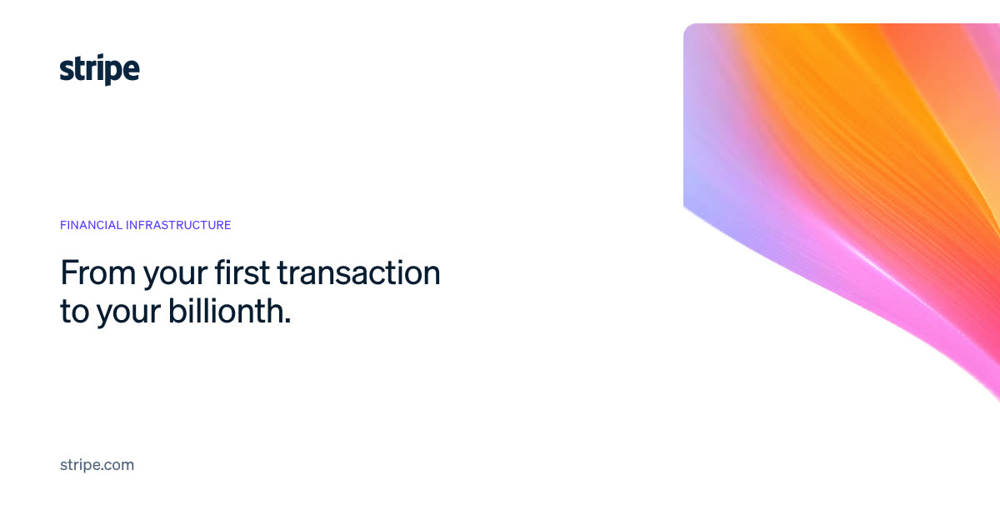
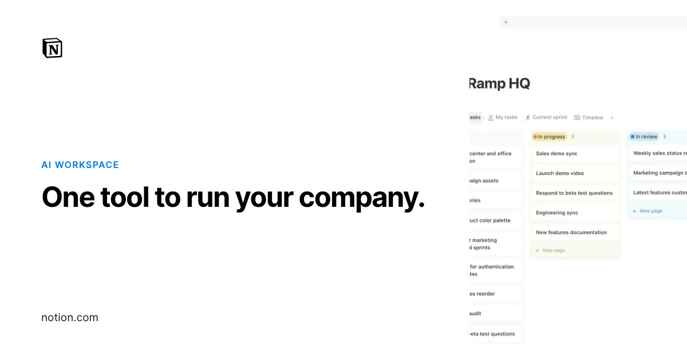
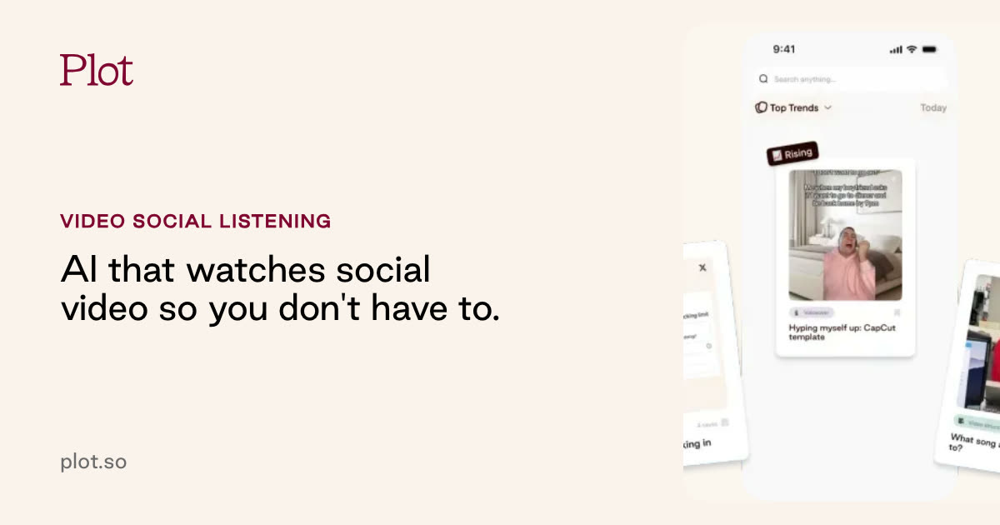
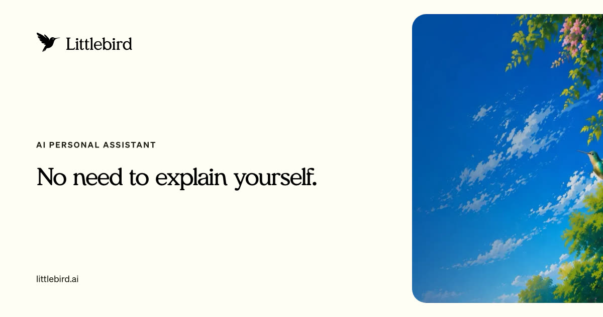
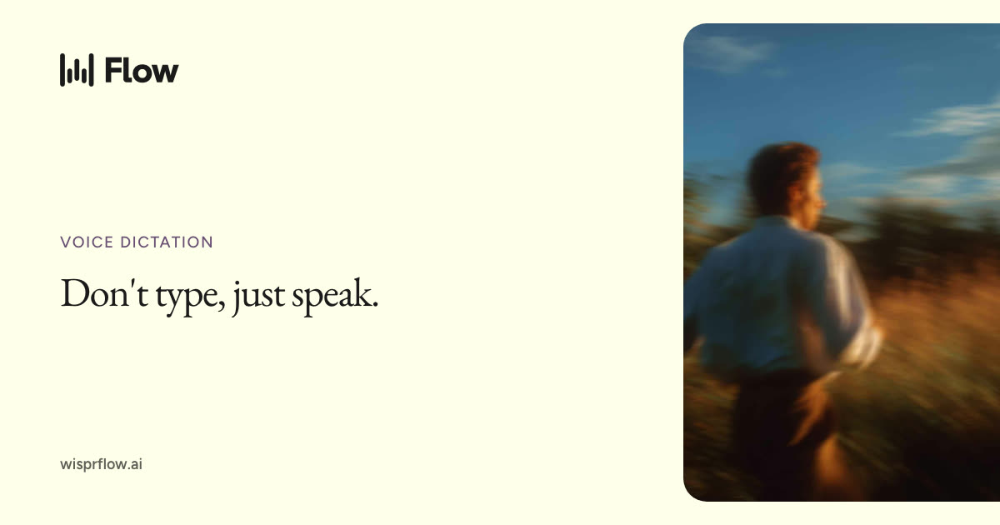
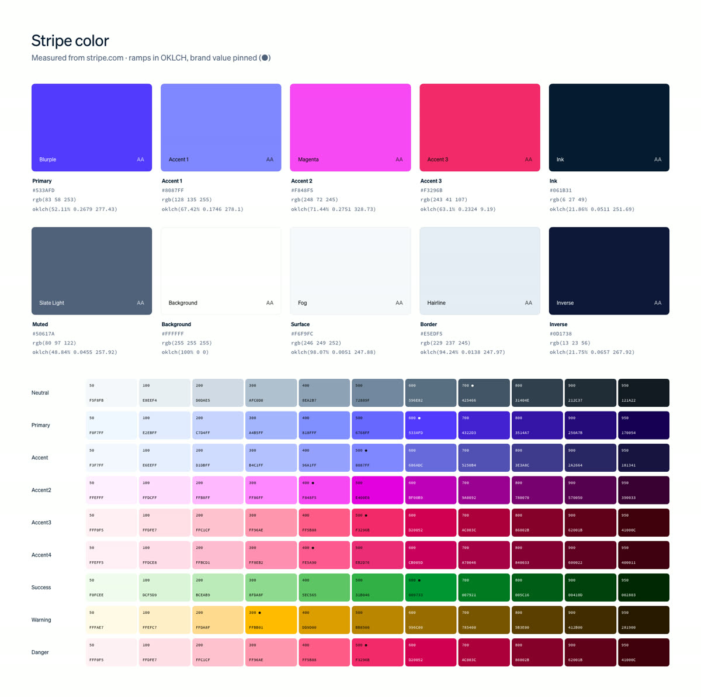

<div align="center">

# watercolor

**Turn any URL into a complete brand identity toolkit.**

Real colors, type, logo, icons, voice, imagery, motion, shaders and product demos — extracted from the live site,<br>understood by an agent trained on great brand work, and rendered into everything a team needs.

[Install](#install) · [What you get](#what-you-get) · [How it works](#how-it-works) · [WATERCOLOR.md](docs/WATERCOLOR-SPEC.md) · [Modes](#modes) · [CLI](#cli)

</div>

---

```bash
watercolor https://stripe.com
```

```
brand/
├── WATERCOLOR.md          ← one file an agent (or human) can build anything on-brand from
├── guidelines/            ← interactive brand book (HTML) + brand-book.pdf
├── tokens/                ← tokens.css · tailwind.css (v4) · tokens.json (W3C DTCG) · tokens.figma.json · tokens.ts · tokens.scss
├── docs/                  ← BRAND · VOICE · DESIGN · COLOR · TYPOGRAPHY · LAYOUT · MOTION · COMPONENTS · ICONOGRAPHY
├── logo/                  ← SVG/PNG variants, auto-split mark, favicon set + manifest, iOS/macOS/Android icons, lockups
├── colors/                ← spec sheet, Adobe .ase, .gpl, JSON
├── typography/            ← specimen
├── patterns/              ← watercolor wash, mesh gradient, contours, grids, mark lattice, orbits… (PNG + SVG/tiles)
├── social/                ← OG images, X/LinkedIn banners, IG post & story, YouTube thumb, quote card, avatar (+ editable HTML)
├── templates/             ← slide deck (HTML + PDF), business cards, letterhead, email signature, video-call background
├── motion/                ← logo reveal, living gradient loop, kinetic type, loader, wipe, end card (MP4/WebM/GIF) + motion.css
├── captured/              ← everything taken from the site: logos, fonts, icons, images, videos, GIFs, Lottie, Rive,
│                            WebGL shader sources, canvas recordings, component screenshots, scroll recording
├── brand.json             ← the measured profile
└── strategy.json          ← the agent's judgment: positioning, personality, voice, overrides
```

## Gallery

Five real brands, run end to end ([all examples →](examples/)):

| | | |
|---|---|---|
| [](examples/stripe/) | [](examples/notion/) | [](examples/plot/) |
| **Stripe** — WebGL ribbon captured from the hero, Söhne Light, two-tone headlines | **Notion** — Inter 700 at −0.035em, flat, real product UI | **Plot** — cream and oxblood, Good Sans, creator video |
| [](examples/littlebird/) | [](examples/wisprflow/) | [](examples/stripe/) |
| **Littlebird** — Meraki serif, ink pills, official press-kit logos | **Wispr Flow** — EB Garamond, lavender CTA, forest green | Color spec sheet: roles, OKLCH ramps with pinned brand values |

<sub>Brand marks shown belong to their owners and appear only to demonstrate the output.</sub>

## Why

Every "AI brand generator" gives you the same purple gradient and Inter. watercolor starts from **evidence**: it opens the site in a real browser, measures every visible element, hovers the buttons, records the canvases, hooks WebGL to capture the shaders behind animated gradients, downloads the fonts, the Lottie files and the product videos — then hands that evidence to an agent equipped with an opinionated library on what separates great brand systems from slop, by category (B2B SaaS, AI, devtools, fintech, consumer).

The result reads like it was written by the company's head of brand, not a template.

## Install

### As a Claude Code skill (recommended)

```bash
/plugin marketplace add rayhankhilji/watercolor
/plugin install watercolor
```

Then just ask: *"Make a brand kit for linear.app"* — or *"reimagine notion.com's brand for a developer audience"*.

Or copy `skills/watercolor` into `~/.claude/skills/` (or any agent that supports Agent Skills).

### As a CLI

```bash
git clone https://github.com/rayhankhilji/watercolor && cd watercolor
npm install && npm run build && npm link
npx playwright install chromium     # once
watercolor doctor
```

Requires Node ≥ 20. `ffmpeg` is needed for video/GIF output (`brew install ffmpeg`, or `npm i ffmpeg-static`).

## What you get

| | |
|---|---|
| **WATERCOLOR.md** | The trademark single-file brand spec: 16 sections from hard rules to implementation, every value measured or marked *derived*. [Format spec →](docs/WATERCOLOR-SPEC.md) |
| **Color** | Roles (background, surface, ink, muted, border, primary, accents, inverse, semantic) from usage-weighted measurement — not just "most common hex". OKLCH ramps with the brand's exact value pinned. WCAG + APCA contrast. A derived counter-theme (dark for light brands). |
| **Typography** | Real families (human + CSS names), captured font files, proprietary → open alternatives (Söhne → Inter Tight, Circular → Plus Jakarta Sans…), the full scale with exact tracking and leading. |
| **Logo** | Header/footer/favicon/mask-icon/manifest/OG/official press-kit logos, scored. The symbol is **automatically split** from lockups by measuring rendered geometry. Recolored variants, favicon `.ico`/`.svg`/PNG set, `site.webmanifest`, iOS/macOS/Android icons. |
| **Motion** | Every transition, curve and `@keyframes` in use, named by character. Canvases recorded via `captureStream`, WebGL shader sources captured, Lottie/Rive downloaded, scroll-through recorded. Then rendered: logo reveal, seamless living-gradient loop (WebGL), kinetic headline, loader, wipe, end card — on the brand's own curves. Optional Remotion project. |
| **Voice** | The full copy corpus plus measured mechanics: heading case, sentence length, reading grade, you/we, punctuation, Oxford comma, recurring terms. Agent-written principles, vocabulary, rewrites and taglines. |
| **Components** | Exact computed CSS of real buttons (with **measured hover states**), inputs, cards, badges, nav and footer, with screenshots. |
| **Company** | B2B/B2C/prosumer, product-led vs sales-led, category, customers from the logo wall, proof stats, competitors and positioning. |
| **Assets** | Patterns, social/OG templates, slides, cards, letterhead, signature, palette & type sheets — all rendered in the brand's real fonts. |

## How it works

```
url ──▶ capture ──▶ extract ──▶ brief.md ──▶ agent writes strategy.json ──▶ build
        Chromium     brand.json   evidence     (judgment, with the            tokens, docs, logo kit,
        crawl+hooks               pack         reference library)             patterns, social, motion,
                                                                              brand book
```

1. **Capture** — Playwright visits the homepage and the pages that carry brand signal (brand/press, about, pricing, product, customers, careers), declines cookie banners, scrolls everything, records the network (fonts, CSS, SVG, GIF, Lottie, Rive, video), hooks `shaderSource` and `getContext`, hovers CTAs, screenshots components, records canvases and a scroll-through, and captures mobile.
2. **Extract** — an in-page collector aggregates every visible element by painted area and rendered characters; Node turns it into a typed [`brand.json`](src/profile/schema.ts).
3. **Strategy** — the agent reads `brief.md`, the screenshots and the [reference library](skills/watercolor/references/) and writes [`strategy.json`](src/profile/strategy.ts). No agent? `watercolor synthesize` does it with Claude via the API.
4. **Build** — deterministic generators render everything with headless Chromium and ffmpeg.

## Use with any agent

The skill is plain Markdown + a CLI, so it works beyond Claude Code. With Cursor, Codex, Gemini CLI or any coding agent:

1. `watercolor extract https://example.com -o brand`
2. Ask the agent: *"Read brand/.watercolor/brief.md and skills/watercolor/references/, look at the screenshots it lists, and write brand/strategy.json."*
3. `watercolor build brand`

Then point your agent rules file (`AGENTS.md`, `.cursorrules`, `CLAUDE.md`) at `brand/WATERCOLOR.md`.

## Modes

| | |
|---|---|
| `extract` | Document the brand exactly as it is. |
| `extend` | Keep everything; fill the gaps (semantic colors, motion signature, patterns, icons) inside the brand language. |
| `evolve` | A considered refresh: recognisable, but stronger. Every change justified. |
| `reimagine` | Treat the company as the brief and propose a fresh, distinctive identity. |

```bash
watercolor notion.com -m reimagine
watercolor mode evolve brand && watercolor build brand
```

## CLI

```
watercolor <url>                 extract + build
watercolor extract <url>         capture → brand.json + .watercolor/brief.md
watercolor build [dir]           render everything from brand.json + strategy.json
watercolor profile [dir]         rebuild brand.json from the saved capture (no re-crawl)
watercolor brief [dir]           (re)write the agent brief
watercolor mode <mode> [dir]     switch extract | extend | evolve | reimagine
watercolor synthesize [dir]      write strategy.json with Claude (ANTHROPIC_API_KEY)
watercolor imagine [dir]         optional on-brand imagery (OPENAI_API_KEY or FAL_KEY)
watercolor remotion [dir]        scaffold a Remotion project wired to the brand
watercolor doctor                check Chromium / ffmpeg
```

Common flags: `-o <dir>`, `-p <pages>`, `--include <urls…>`, `--fast`, `--no-motion`, `--no-videos`, `--no-recording`, `--headed`.

### Image generation (optional)

Everything is code-generated by default: deterministic, editable, free. `watercolor imagine` adds what code can't draw — campaign photography, illustration in the brand's style, product-in-scene shots — with prompts composed from the brand profile so output stays on-brand.

### Remotion (optional)

`watercolor remotion` scaffolds `brand/remotion/` with LogoReveal, Headline and Sizzle compositions using the brand's tokens, fonts, screenshots and captured product videos. Remotion is free for individuals and companies of up to 3 people; larger companies need a [company license](https://remotion.dev/license).

## Programmatic API

```ts
import { extract, build } from "watercolor-cli";
await extract("https://linear.app", "brand/linear");
await build({ dir: "brand/linear" });
```

## Responsible use

Logos, fonts and imagery belong to their owners. watercolor is for working on brands you own or represent, client work and research. Captured font files are for local reference — license proprietary faces before shipping. The crawler visits a handful of pages, declines non-essential cookies and identifies as a standard headless Chromium.

## License

MIT © Rayhan Khilji
