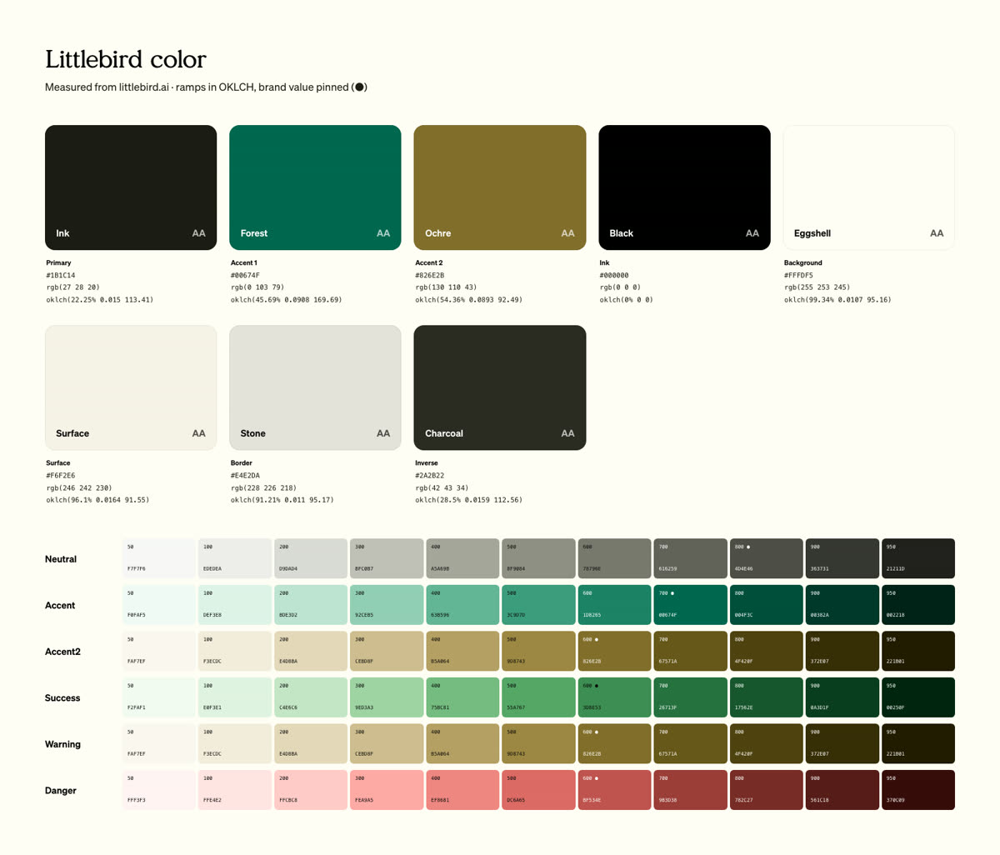
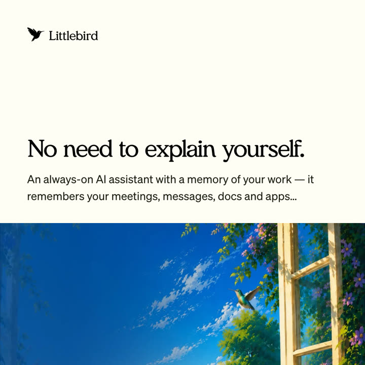
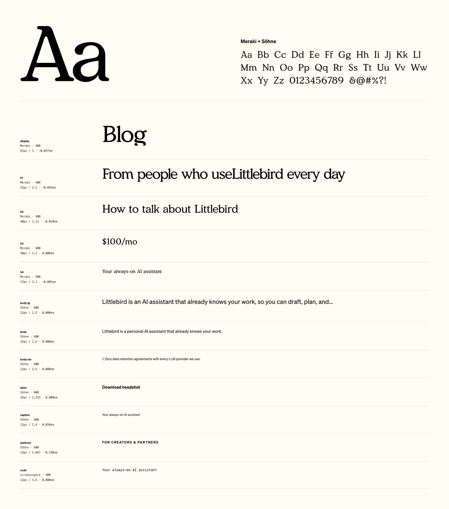
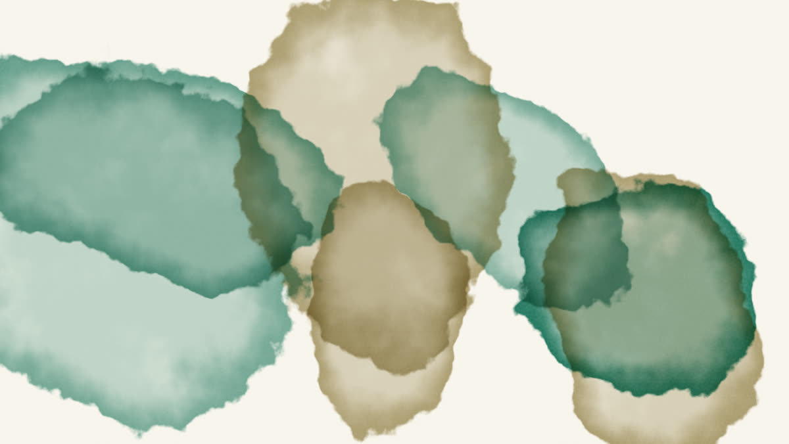
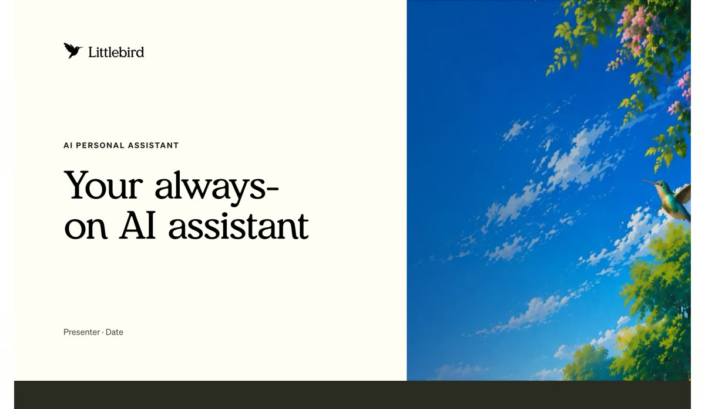
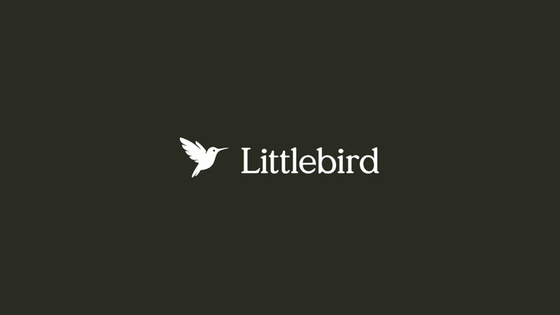
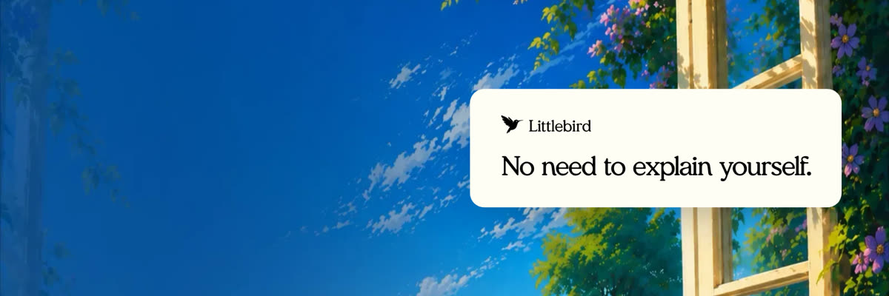

# Littlebird — example kit

Generated by watercolor from [littlebird.ai](https://littlebird.ai) in `extract` mode. Strategy written by Claude following the skill.

> An always-on AI assistant with a memory of your work — it remembers your meetings, messages, docs and apps, then takes action so you never lose context.

- **[WATERCOLOR.md](WATERCOLOR.md)** — the full brand file
- **[strategy.json](strategy.json)** — the agent's judgment layer

| | |
|---|---|
|  |  |
|  |  |
|  |  |
|  |  |
|  |  |

Littlebird's logos, fonts and imagery belong to Littlebird. Shown only to demonstrate watercolor's output.
